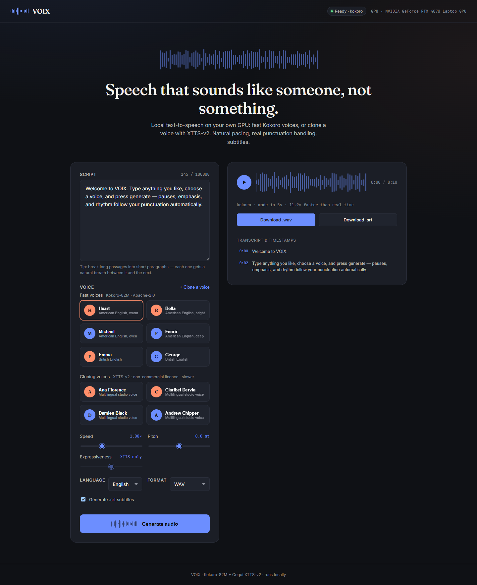

# VOIX — local AI text-to-speech

[](https://github.com/Sanjay5704/VOIX.AI/actions/workflows/ci.yml)

Type a script, pick a voice, get natural-sounding speech with subtitles. Runs on
your own computer (GPU or CPU). You can also clone a voice from a short clip.

Built with **FastAPI**, **React** and two open-source TTS models:

| Model | What it's good at | Licence |
|---|---|---|
| [Kokoro-82M](https://huggingface.co/hexgrad/Kokoro-82M) | Fast, light, clear. The default. | Apache-2.0 |
| [Coqui XTTS-v2](https://huggingface.co/coqui/XTTS-v2) | Voice cloning from a 3–60 s clip, many languages | Non-commercial only |



## Features

- Two voice engines in one app: pick a voice and VOIX uses the right model.
- Voice cloning from your own recording (XTTS), with a permission checkbox.
- Natural pacing: text is split into sentences, with pauses based on punctuation
  (`.` `?` `!` pause longer than `,`) and common abbreviations expanded (`Dr.` → "Doctor").
- Speed and pitch control, loudness normalisation, WAV or MP3 output (ffmpeg).
- SRT subtitles with per-sentence timestamps, and a clickable transcript in the player.
- Batch generation endpoint and auto-generated API docs at `/docs`.

## How it works

```
text ──► split into sentences ──► model speaks each sentence ──► join with pauses
     ──► pitch / speed / loudness (ffmpeg) ──► .wav / .mp3  +  .srt subtitles
```

- `backend/app/services/engines.py` — the two models behind one small interface
  (`synthesize_chunk(text, voice) -> audio`). Models load once and stay in memory.
- `backend/app/services/synthesis_service.py` — the pipeline above.
- `backend/app/utils/` — text splitting, ffmpeg audio processing, SRT writing.
- `frontend/` — single-page React app (Vite).

## Benchmark: Kokoro vs XTTS on my laptop

I wrote a benchmark (`benchmarks/`) that renders 6 test scripts 3 times with each
model, measures speed and GPU memory, then runs the audio through **Whisper**
(speech-to-text) to check the words come out right. Full results:
[docs/BENCHMARK.md](docs/BENCHMARK.md).

Measured on an **RTX 4070 Laptop GPU (8 GB)**:

| | Kokoro-82M | XTTS-v2 |
|---|---:|---:|
| Speed | **14.4× faster than real time** | 1.5× faster than real time |
| Word error rate (Whisper) | **0.4%** | 2.3% |
| GPU memory | **747 MB** | 2,028 MB |
| One short sentence | 0.3 s | 8.0 s |

What I took from it: Kokoro is the better default (faster, clearer, free to use);
XTTS is worth its cost only when you need a cloned voice. XTTS speed also varied a
lot between runs of the same text (5–25 s), which I'd like to investigate next.

## Run it (Windows)

Needs Python 3.11, Node 18+, and [ffmpeg](https://ffmpeg.org/) on PATH. An NVIDIA GPU
is optional but much faster.

```powershell
# 1. Backend
python -m venv env
.\env\Scripts\pip install torch torchaudio --index-url https://download.pytorch.org/whl/cu124
.\env\Scripts\pip install -r backend\requirements-ml.txt
cd backend
..\env\Scripts\python -m uvicorn app.main:app --port 8000
```

```powershell
# 2. Frontend (second terminal)
cd frontend
npm install
npm run dev
```

Open http://localhost:3000. The first run downloads the models (Kokoro ~330 MB,
XTTS ~1.8 GB). Using XTTS means accepting the Coqui Public Model License.

Options go in `backend/.env` (see `backend/.env.example`), e.g.
`ENABLED_ENGINES=kokoro` to run without XTTS.

## API example

```powershell
curl -X POST http://localhost:8000/api/v1/generate `
  -H "Content-Type: application/json" `
  -d '{"text": "Hello from VOIX.", "voice_id": "af_heart", "output_format": "mp3"}'
```

The response has `audio_url`, `srt_url`, sentence timestamps and how fast it ran.
`GET /api/v1/voices` lists voices; `POST /api/v1/voices/clone` clones one.

## Tests

```powershell
cd backend
..\env\Scripts\python -m pytest
```

The tests swap the real model for a fake one that makes tones, so the whole
pipeline (splitting, ffmpeg, subtitles, downloads) is tested without a GPU.
GitHub Actions runs them, plus lint and the frontend build, on every push.

## Run the benchmark yourself

```powershell
.\env\Scripts\python -m benchmarks.run_benchmark --engines kokoro,xtts
```

## How this was built

This started as my single-user XTTS app (the first commit). I then refined it with
help from an AI coding assistant (Claude Code): the Kokoro engine, bug fixes, the
benchmark, tests and CI. I ran every benchmark on my own GPU, and every number
here comes from those runs.

## Licence notes

XTTS-v2 is non-commercial only, and Coqui (the company) has shut down, so no
commercial licence can be bought. Kokoro-82M is Apache-2.0. Only clone voices you
have permission to use. No licence has been chosen for this project's own code yet.
