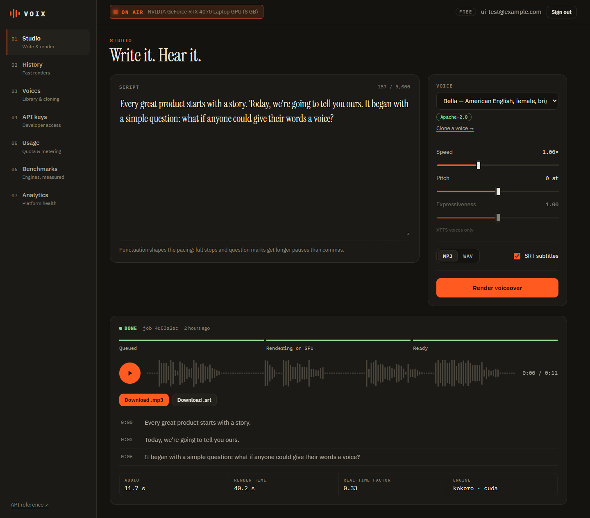
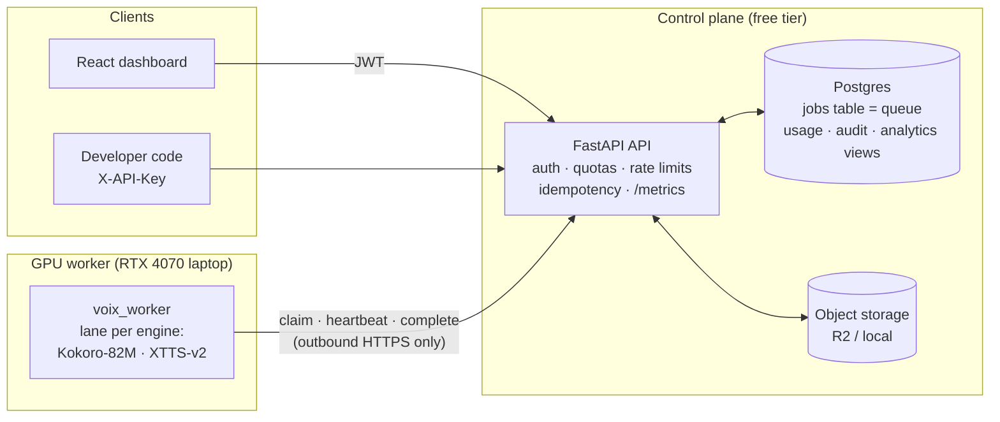
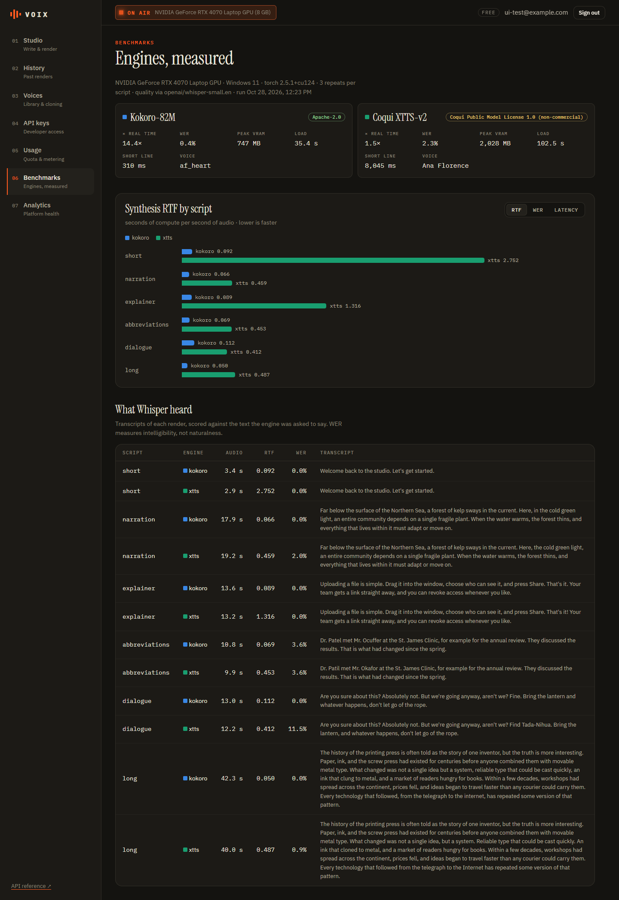
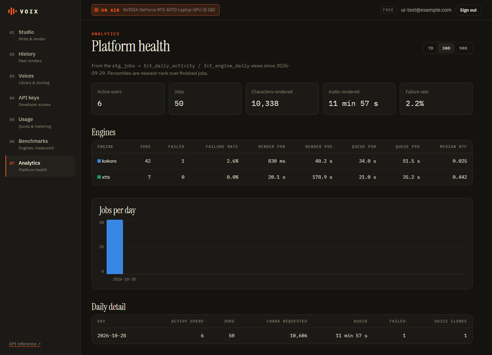

# VOIX — AI voiceover studio + developer TTS API

[](https://github.com/Sanjay5704/VOIX.AI/actions/workflows/ci.yml)

Paste a script → pick or clone a voice → get a voiceover with SRT subtitles.
The same engine is a REST API with API keys, quotas and usage metering.
Rendering happens on a GPU worker that **pulls** jobs from the cloud API, so a
laptop behind home Wi-Fi can serve a hosted product.



## Architecture



1. `POST /v1/jobs/tts` validates, checks quota + rate limit, inserts a `queued` job → `202`.
2. The worker long-polls `/internal/jobs/claim`. The API takes the next job with
   `SELECT … FOR UPDATE SKIP LOCKED` and leases it to that worker.
3. The worker chunks the text, synthesises each chunk, adds punctuation pauses,
   applies pitch/speed/loudness with ffmpeg, writes MP3/WAV + SRT, and heartbeats
   to extend the lease and report progress.
4. It uploads the files; the API stores them and records usage. The dashboard
   polls the job and plays the result.

If the laptop is off, jobs wait in the queue and `/v1/health` reports the worker offline.
If it dies mid-job, the lease expires and the job is retried (then failed after `max_attempts`).

## Measured on an RTX 4070 Laptop GPU

From [docs/BENCHMARK.md](docs/BENCHMARK.md): 6 scripts × 3 repeats through the
production pipeline, each render transcribed by Whisper and scored against its script.

| Engine | Throughput | Word error rate | Peak VRAM | Licence |
|---|---:|---:|---:|---|
| Kokoro-82M | **14.4× real time** | **0.4%** | **747 MB** | Apache-2.0 |
| XTTS-v2 | 1.5× real time | 2.3% | 2,028 MB | non-commercial |

XTTS latency also varied widely for identical input (5.2–25.2 s for one script),
while Kokoro's repeats agreed within a few percent. Real-load results and other
measurements are in [docs/MEASUREMENTS.md](docs/MEASUREMENTS.md).

| Benchmarks | Analytics (operators) |
|---|---|
|  |  |

## Features

- **Studio:** script editor with live character limits, voice picker grouped by
  engine with licence labels, speed/pitch/expressiveness, MP3/WAV, SRT, live job
  status, player with the real waveform and clickable subtitle cues.
- **Voice cloning with consent:** two-step upload; the consent statement, time and
  IP are stored with the voice and written to an audit log. Clips are standardised
  by the worker (mono 22.05 kHz, 3–60 s).
- **Developer API:** `vx_live_…` keys (stored as SHA-256, shown once),
  `Idempotency-Key` replay/conflict handling, keyset pagination, authorised
  downloads (local streaming or presigned R2 redirects). OpenAPI docs at `/docs`.
- **Limits:** monthly character quotas per plan and per-user rate limits,
  computed from the database under a row lock, so they hold across API instances.
- **Benchmarks:** `/v1/engines` and the Benchmarks page show measured speed,
  WER, VRAM and load time from the latest uploaded run.
- **Analytics:** dbt-style SQL models (`stg_jobs → fct_engine_daily,
  fct_daily_activity`) that run on Postgres and SQLite: DAU, volume, failure
  rate, p50/p95 render time and queue wait per engine. See [docs/ANALYTICS.md](docs/ANALYTICS.md).
- **Operations:** JSON logs with request IDs, Prometheus `/metrics` (HTTP, jobs,
  queue depth, workers online), security headers + CSP, graceful worker shutdown
  that hands the job back without spending a retry.

## Design decisions and trade-offs

| Decision | Why | Trade-off |
|---|---|---|
| Postgres as the queue (`SKIP LOCKED` + leases), no Redis | One stateful service on a free tier; jobs and their state change in one transaction. | Polling instead of push; fine at this scale, not for thousands of jobs/s. |
| Pull-based worker over HTTPS | Works behind NAT with no tunnel or open port; the API never needs to reach the GPU. | Up to one poll interval of extra latency (long-poll keeps it small). |
| Lazy lease reaping on claim/health | No scheduler process to run or pay for. | A dead worker's job is only requeued when someone polls (the worker or health check). |
| Quotas and rate limits from the `jobs` table | Correct across API instances without Redis. | An extra indexed query per job creation. |
| Separate `api/` and `worker/` packages | API image stays small (no torch); worker has no database access or credentials. | The JSON contract is duplicated; the e2e test guards it. |
| Kokoro as the default engine | Apache-2.0, ~10× XTTS throughput, a third of the VRAM. | No cloning; XTTS is kept for that and labelled non-commercial. |
| Analytics as SQL views in the app DB | Always fresh, no pipeline to schedule, same models in tests. | Heavier queries share the OLTP database; a warehouse would come first at scale. |
| One claim loop ("lane") per engine in the worker | Real load showed **head-of-line blocking**: Kokoro jobs waited a median 34 s behind slow XTTS jobs. Lanes cut that to **2.2 s** (p95 51.5 s → 5.1 s). | Engines share the GPU, so renders are somewhat slower while both run. `LANES=shared` keeps the old single loop. |

## Run it

Windows PowerShell commands are in [docs/RUNNING.md](docs/RUNNING.md) (API, GPU worker,
dashboard, tests). Free-tier deployment (Render + Neon + Cloudflare R2 + Cloudflare Pages
+ laptop worker) is in [docs/DEPLOY.md](docs/DEPLOY.md).

```
api/        FastAPI control plane, SQLAlchemy 2.0 models, Alembic migrations, analytics models, tests
worker/     GPU worker: engines (Kokoro, XTTS, mock), synthesis pipeline, lease-keeping runner
frontend/   React dashboard (studio, history, voices, API keys, usage, benchmarks, analytics)
benchmarks/ multi-engine benchmark: latency, RTF, VRAM, Whisper round-trip WER/CER
tests_e2e/  API + queue + worker in one process with the mock engine
scripts/    load generator, legacy voice import
docs/       RUNNING, DEPLOY, BENCHMARK (generated), ANALYTICS, MEASUREMENTS
```

## Testing and CI

84 automated tests: 47 API, 30 worker, 3 end-to-end, 4 benchmark-metric. GitHub
Actions runs ruff, the API suite on **SQLite and Postgres 16** (including Alembic
upgrade → check → downgrade → upgrade and a 6-thread concurrent-claim test), worker
tests with ffmpeg, the end-to-end suite with the mock engine, the frontend build,
and Docker image builds. The mock engine lets the whole pipeline run on CPU in CI.

## Engines and licences

| Engine | Licence | Commercial use | Cloning |
|---|---|---|---|
| [Kokoro-82M](https://huggingface.co/hexgrad/Kokoro-82M) | Apache-2.0 (weights) | Yes | No, fixed voicepacks |
| [Coqui XTTS-v2](https://huggingface.co/coqui/XTTS-v2) | Coqui Public Model License 1.0 | **No** | Yes, 3–60 s reference |
| Mock | project code | Yes | Yes (ignored) |

Coqui has shut down, so a commercial XTTS licence can no longer be obtained. A
deployment that charges users must run `ENABLED_ENGINES=kokoro`. This project is a
portfolio demo and charges no one. Only clone voices you have permission to use.

## How this was built

I started VOIX as a single-user XTTS app (the first commit) and then rebuilt it
into this architecture with an AI coding assistant (Claude Code), which is why
commits carry a `Co-Authored-By` line. I made the design calls (pull-based worker,
Postgres queue, Kokoro as default after benchmarking), ran every benchmark and
load test on my own GPU, and every number in this README comes from those runs.

## Licence

No licence has been chosen for the project code yet (all rights reserved until one is added).
Model weights keep their own licences (above).
