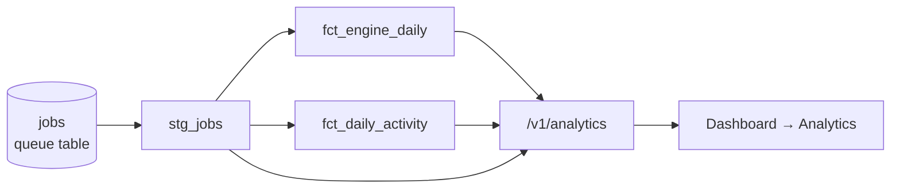

# Analytics

Operational analytics are modelled in SQL, dbt-style, and materialised as views
in the application database. There is no separate warehouse: at this scale the
OLTP database serves both, and views keep the models always fresh.



Source: `api/voix_api/analytics/models/*.sql`. Build:

```powershell
cd api
.\.venv\Scripts\python -m voix_api.analytics build          # also runs on API startup
.\.venv\Scripts\python -m voix_api.analytics show fct_engine_daily   # rendered SQL for this DB
```

## Models

| Model | Grain | What it holds |
|---|---|---|
| `stg_jobs` | one row per job | Typed, flattened job: status flags, UTC `day`, `queue_ms` (enqueue → latest claim), and worker-reported `processing_ms`, `synthesis_rtf`, `audio_seconds` pulled out of the result JSON. |
| `fct_engine_daily` | day × engine | Finished synthesis jobs: volume, succeeded/failed/canceled, failure rate, chars, audio seconds, distinct users, p50/p95 processing time, p50/p95 queue wait. |
| `fct_daily_activity` | day | All jobs: active users (DAU), jobs, characters requested, audio rendered, failures, voice clones. |

## Metric definitions

- **Active user (DAU):** a user who created at least one job that UTC day.
- **Failure rate:** `failed / (succeeded + failed)`. Canceled jobs are user
  intent, not failures, so they are excluded from the denominator.
- **Processing time:** worker wall time for the job (synthesis + ffmpeg
  post-processing, including a cold model load if the job triggered one).
- **Queue wait:** `started_at − created_at`, i.e. how long the job waited for
  a worker. It includes retry back-off and time the worker was offline.
- **Percentiles:** nearest-rank (the ⌈n·p⌉-th smallest value), the same
  definition in SQL and in the API's window-level roll-ups.

## Portability

The models run unchanged on Postgres (production) and SQLite (local dev and
tests). Where the dialects differ, a macro renders the right SQL:

| Macro | Postgres | SQLite |
|---|---|---|
| `{{ day("ts") }}` | `CAST((ts AT TIME ZONE 'UTC') AS DATE)` | `date(ts)` |
| `{{ ms_between("a", "b") }}` | `EXTRACT(EPOCH FROM (a - b)) * 1000.0` | `(julianday(a) - julianday(b)) * 86400000.0` |
| `{{ json_num("col", "k1", "k2") }}` | `CAST((col #>> '{k1,k2}') AS DOUBLE PRECISION)` | `CAST(json_extract(col, '$.k1.k2') AS REAL)` |
| `{{ ref("model") }}` | the model name; also defines build order (topological sort) | same |

Percentiles use `ROW_NUMBER()` / `COUNT(*) OVER` and integer ceiling
(`(n * 95 + 99) / 100`) because SQLite has no `percentile_cont`.

Migrations drop the views first (`migrations/env.py`) so schema changes are
never blocked by a dependent view; the API rebuilds them on start.

## Tests

`api/tests/test_analytics.py` seeds jobs with known timings and checks the
marts against hand-computed values (p50/p95, failure rate, DAU), plus the
admin-only access rule on `/v1/analytics`.
